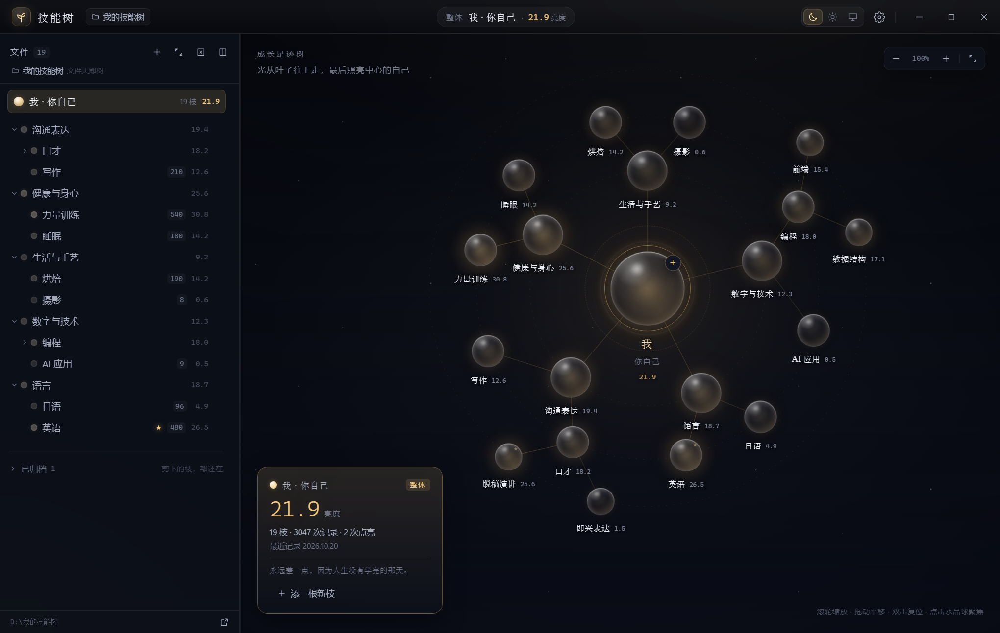
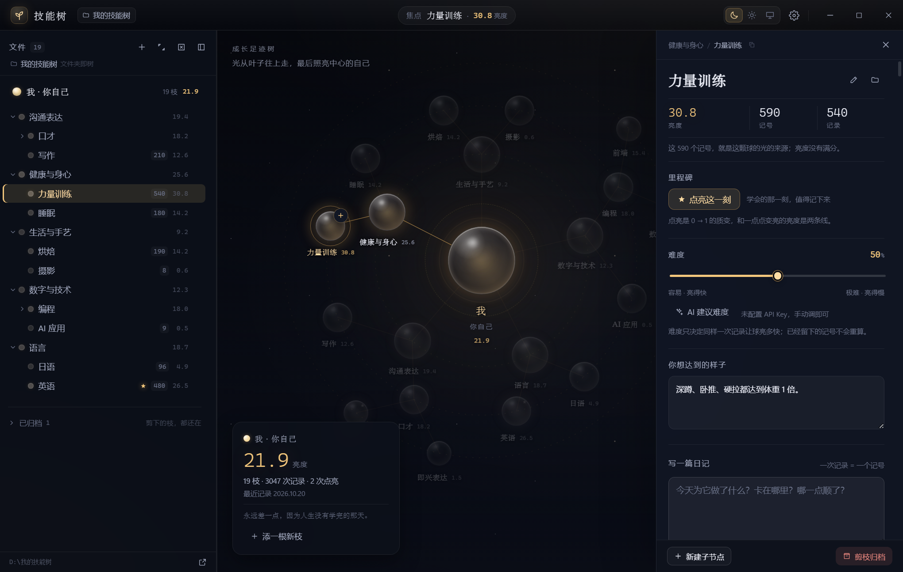
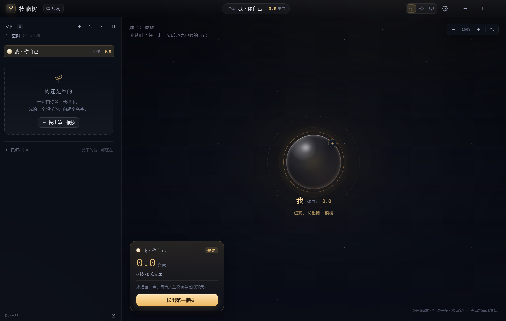

# 个人技能树 · Skill Tree

> **一棵「成长足迹树」。它不给你打分、不催你点满，只记录你点亮了什么、长出了什么。**

个人技能树是一款本地优先的桌面应用：你亲手把技能从中心种出来，每写一篇日记，树上就多一个「记号」，光沿着枝干慢慢往上走，最后照亮中心那颗代表你自己的水晶球。

- **空树开局**：没有任何预置技能、分类或示例节点。
- **没有分数、没有总分、没有进度条**：只有连续的明暗，永远逼近 100，永远不到 100。
- **数据就是文件夹**：整棵树是一个普通目录，`Markdown` 日记 + 少量 JSON，可直接用 Obsidian、文件管理器打开、编辑、备份、带走。



---

## 目录

- [它解决什么问题](#它解决什么问题)
- [界面与交互](#界面与交互)
- [快速开始](#快速开始)
- [数据格式](#数据格式)
- [亮度是怎么算出来的](#亮度是怎么算出来的)
- [AI 难度建议（可选）](#ai-难度建议可选)
- [项目结构](#项目结构)
- [开发](#开发)
- [测试与验收](#测试与验收)
- [打包发布](#打包发布)
- [设计红线](#设计红线)
- [已知边界与后续计划](#已知边界与后续计划)
- [安全说明](#安全说明)
- [License](#license)

---

## 它解决什么问题

| 痛点 | 树的解法 |
|---|---|
| 目标模糊——「学好英语」无从下手 | 用树把大目标拆成一层层小目标 |
| 任务一多就遗忘 | 每次点亮都留痕，树本身就是日记 |
| 没记录、难坚持 | 看得见成长——点亮的节点越来越多、越来越深 |

核心结构：

```
中心 · 我（用户自己）
   └── 根 · 分类（用户自定义）
          └── 枝 · 技能
                 └── 叶 · 可点亮节点（唯一可点亮的单位）
```

结构上是树，视觉上是从中心向外辐射的水晶球：越靠近中心球越大、亮得越慢；越往外的叶子越小，但更容易看出变亮。

---

## 界面与交互

### 深色 · 整体视图


- 左侧是文件树（数据的真相），右侧是能量球（成长的观感），本质是同一个文件夹的两个投影。
- 点左侧文件 → 右侧高亮对应水晶球，其余淡出；点右侧水晶球 → 左侧自动展开并定位。
- 顶部显示当前焦点和亮度数值；右上角是主题切换、设置与窗口控制（— □ ×）。
- **标题栏拖动**：顶部 46px 内、按钮与中间焦点胶囊之外的空白都可以按住移动窗口；窗口控制按钮、主题切换和焦点胶囊本身保持可点击。

### 深色 · 节点详情



选中节点后从右侧滑出详情抽屉：

- **亮度 / 记号 / 记录**：亮度是派生值，实时由日记算出。
- **里程碑**：手动「点亮这一刻」，写入时间戳；点亮与亮度是两个独立维度。
- **难度**：0–1 连续值，可手调；决定同样一次记录让球亮多快。
- **你想达到的样子**：写清「学会」是什么状态，可作为 AI 难度建议的输入。
- **写一篇日记**：一次记录 = 一个记号；可勾选「深度投入」= 2 个记号。
- **成长日记**：按日期倒序，可展开、编辑、删除。
- **剪枝归档**：把整个节点文件夹移入 `_archived/`，历史全部保留，可随时接回。

### 浅色 · 整体视图


浅色主题不用「发光」，而用「实心色阶」：从浅灰到饱和暖黄，同一个内核——**这颗球比上个月更黄更亮了**。

### 空树开局



第一次打开只有中心圆自己。点它、点右下角按钮，或按 `Ctrl + N`，长出第一根枝。

### 新建节点


名字会成为文件夹名；描述可稍后再写；难度默认 50%，可拖动，也可让 AI 给建议后自行修改。

### 设置


三档主题、AI 接口、节奏参数（α / kMin / kMax）、数据目录。

---

## 快速开始

### 环境

- Node.js **20.19+**（推荐 22/24）
- npm 10+
- Windows 10/11（本项目主要在 Windows 11 + 150% 缩放下验收；macOS / Linux 的打包配置已提供但未实测）

### 开发运行

```bash
npm install
npm run dev
```

`npm run dev` 会先用 `tsc` 编译主进程，再启动 Vite（渲染进程热更新）与 Electron。

> 国内网络下载 Electron 慢时，项目 `.npmrc` 已配置 npmmirror 镜像。若二进制没装上：
>
> ```bash
> node node_modules/electron/install.js
> ```
>
> 仍失败时，把缓存指到一个可写目录后再试：
>
> ```powershell
> $env:electron_config_cache="D:\electron-cache"
> node node_modules/electron/install.js
> ```

### 生产预览

```bash
npm run build
npm start
```

### 打包 Windows 安装包

`npm run dist` 会做标准 electron-builder 打包，但**不会自动套启动器**。正式发布包需要多一步：

```powershell
npm run build
npx electron-builder --win --dir --config.directories.output=release-build
powershell -NoProfile -ExecutionPolicy Bypass -File scripts/build-launcher.ps1 -AppDir release-build\win-unpacked
npx electron-builder --win --x64 --prepackaged release-build\win-unpacked
```

`build-launcher.ps1` 会把 `SkillTree.exe` 重命名为 `SkillTree-app.exe`，再编译启动器为 `SkillTree.exe`。生成的 `release/win-unpacked` 才是可发布目录。

> CI（GitHub Actions）不安装 .NET Framework 编译器，因此直接使用仓库里的 `build/launcher.exe`；重新编译启动器只在本地需要时运行 `scripts/build-launcher.ps1`。

免安装 ZIP 用任意压缩工具把 `release/win-unpacked` 打成 `SkillTree\` 目录（保留 `启动说明.txt`），压缩级别 5 左右即可。

> 启动器源码在 `build/launcher.cs`，使用 .NET Framework 4.8 的 `csc.exe` 编译，无第三方依赖。

产物在 `release/`：

- `release/SkillTree-1.0.0-Setup.exe`：**一键安装版**，按当前用户安装到 `%LOCALAPPDATA%\Programs\SkillTree`，无需管理员、无需选择目录，装完自动启动。
- `release/SkillTree-1.0.0-portable.zip`：**免安装版**，解压后双击 `SkillTree\SkillTree.exe`，不写注册表、不装任何东西。
- `release/win-unpacked/`：免安装目录本体。

> **关于 `SkillTree.exe`**：它现在是一个很小的**启动器**（约 85 KB），真正的主程序是旁边的 `SkillTree-app.exe`（约 240 MB）。
> 启动器会先按默认方式启动；如果当前 Windows 会话无法创建 Chromium 沙箱或 GPU 初始化卡住（部分受限会话、安全软件、远程桌面环境会出现），它会自动带 `--no-sandbox --disable-gpu` 重启一次。正常机器上不会关闭沙箱、也不会禁用 GPU。
> 因此 **`SkillTree.exe` 和 `SkillTree-app.exe` 都要保留**，不要只复制其中一个。

安装包未签名，Windows SmartScreen 可能提示；个人使用点「更多信息 → 仍要运行」即可。文件校验值见 `release/SHA256SUMS.txt`。

### 安装不上 / 打不开怎么办

1. **优先试免安装版**：完整解压 `SkillTree-1.0.0-portable.zip`，保留整个 `SkillTree` 文件夹，双击里面的 `SkillTree.exe`。
   **不要只把 `SkillTree.exe` 单独复制出来**——它依赖同目录的 `SkillTree-app.exe`、`resources`、DLL、`.pak` 文件。
2. **双击后完全没进程 / 没窗口**：先用新版的 `SkillTree.exe` 启动器（会自动切兼容模式）。如果仍然没有窗口，打开任务管理器看有没有 `SkillTree-app.exe`；再在命令提示符里运行 `SkillTree-app.exe --no-sandbox`，会显示更具体的错误。
3. **SmartScreen / 安全中心拦截**：右键安装包 → 属性 → 勾选「解除锁定」→ 确定；或在提示里点「更多信息 → 仍要运行」。
4. **杀毒软件拦截**（360、火绒、Defender 等）：这是未签名安装包，容易被误报。把安装包和安装目录加入信任区；或直接用免安装版。
5. **想重置界面状态**：删除安装目录下的 `.skilltree-userdata` 文件夹即可。它**不是** `%APPDATA%\personal-skill-tree`——本应用把 Chromium 缓存放在安装目录里，以防受限会话无法写 AppData。技能树数据仍在「我的文档\个人技能树」，不受影响。
6. **系统要求**：Windows 10 / 11，x64。32 位 Windows 无法运行 Electron 44；ARM64 Windows 可通过 x64 模拟运行，但未实测。启动器使用 .NET Framework 4.8（Windows 10/11 自带）。
7. **安装程序无反应/卡住**：确认安装包在本地磁盘（不要从网络共享或压缩软件里直接运行），并留出至少 1 GB 磁盘空间；杀毒软件首次扫描 250 MB 文件可能等待 1–3 分钟。
8. **仍然失败**：把具体提示文字或截图发我（尤其是「Windows 已保护你的电脑」「此应用无法在你的电脑上运行」「安装程序无法创建临时文件」等），可以针对性处理。长期方案是给安装包做代码签名。

### 数据目录与配置目录

技能树数据默认：`我的文档/个人技能树`（Windows 上通常是 `%USERPROFILE%\Documents\个人技能树`）。

- **受限会话兜底**：如果系统策略让 `我的文档` 不可写，应用会自动改用安装目录下的 `我的技能树`，并在「设置 → 数据」里显示实际路径。卸载或删除安装目录前，请先把这份数据备份走。
- 设置里可「更换数据文件夹」；换目录就是换一棵树，原目录不会被删除。
- 开发/测试可用环境变量覆盖：

```powershell
$env:SKILL_TREE_DATA_DIR="D:\my-tree"
npm start
```

界面缓存、窗口状态等产品级配置放在**安装目录**下的 `.skilltree-userdata`，不在 `%APPDATA%`：

- 便携版：解压目录\`.skilltree-userdata`
- 安装版：`%LOCALAPPDATA%\Programs\SkillTree\.skilltree-userdata`
- 删除它只会重置界面（主题、窗口大小等），**不会**动技能树数据。

---

## 数据格式

> **文件夹即节点，节点即文件夹。** 父子关系由文件夹嵌套表达，不另存一份结构。

```text
个人技能树/                      # 中心圆（你自己）
├── config.json                  # 产品级设置（API key、α、k 参数、主题）
├── 沟通表达/                    # 一级节点
│   ├── .node.json               # 该节点状态：description / difficulty / litAt
│   └── 口才/                    # 二级节点
│       ├── .node.json
│       ├── 2026-10-15.md        # 一篇日记 = 一个记号
│       └── 2026-10-17.md
└── _archived/                   # 归档区（剪枝不删历史）
    ├── .archive.json            # 归档清单：文件夹 → 原位置
    └── 公开演讲/
```

### `.node.json`

```json
{
  "description": "能不看稿、流畅地讲满 10 分钟，逻辑清楚",
  "difficulty": 0.7,
  "litAt": "2026-06-15T20:00:00.000Z"
}
```

- 只存**用户输入**：描述、难度、点亮时间。
- **不存亮度、不存记号数**——它们每次扫描时现算。
- `litAt` 未点亮时省略。

### 日记 `.md`

```markdown
---
date: 2026-10-17
deep: true
---

今天对着镜子脱稿练了 20 分钟，卡壳 3 次，后面顺了。
```

- 文件名按日期：`YYYY-MM-DD.md`；同一天多篇自动加 `-2`、`-3` 后缀。
- `deep: true` = 深度投入 = 2 个记号；省略或 `false` = 普通 = 1 个记号。
- 没有「分钟」「分数」等字段，系统不做任何折算。
- 用 Obsidian 直接编辑、手写 frontmatter 也能正确读取（兼容 BOM / CRLF）。
- 正文以纯文本展示，不渲染 HTML，日记里的内容不会成为可执行标记。

### `config.json`

```json
{
  "apiKey": "",
  "baseUrl": "https://api.deepseek.com",
  "model": "deepseek-chat",
  "alpha": 0.6,
  "kMin": 0.00025,
  "kMax": 0.001,
  "preferences": {
    "theme": "system",
    "splitRatio": 0.24
  }
}
```

- `alpha`：向上传递衰减系数，默认 0.6（每上一层，光只剩 60%）。
- `kMin` / `kMax`：最难 / 最易节点的变亮速度。
- `preferences.theme`：`dark` / `light` / `system`。
- API Key 只存在本地，不会上传；`.gitignore` 已忽略根目录的 `config.json`。

---

## 亮度是怎么算出来的

**一次记录 = 一个记号。** 无论日记写的是「练了 20 分钟」「背了 50 个单词」还是「今天随便弄了弄」，都只记一次；勾选「深度投入」记两次。

记号会沿树向上传递，每层乘一次 `α`：

```
叶子节点（深度 d）的 1 个记号
  本节点      += 1
  父节点      += α
  祖父节点    += α²
  ……
  中心圆      += α^d
```

每个节点用自己的 `k` 把累计记号换算成亮度：

```
k = kMin + (kMax − kMin) × (1 − difficulty)
亮度 = 100 × (1 − e^(−k × 记号数))
```

- `k` 取 0.00025～0.001 量级，**所有节点都慢**：单篇几乎无感，一年才明显。
- 指数函数恒大于 0，所以**亮度永远小于 100**，只能无限逼近。
- 中心圆的等效难度为 1（`k = kMin`），且收到的记号被 `α^depth` 衰减，因此几乎照不亮——这正对应「人生没有学完的那天」。
- 默认参数下（每天记一次）：最容易的事一年约 31%，最难的事一年约 9%，中心圆还要再慢一层。

**为什么不做「分钟折算」**：没有万能的时间单位；成绩、评价不是时间；同样的 10 分钟含金量不同——含金量交给「难度」这个旋钮，而不是时间这把假尺子。

**为什么没有总分**：多颗球各自明暗、并列生长，永不合成一个总分。中心圆是「光汇聚」，回答的是「我这个人被照亮了多少」，不是加权平均分。

---

## AI 难度建议（可选）

- 仅用于**新建节点时建议难度**；日记内容永远不会发送。
- 支持任意 OpenAI 兼容接口：设置里填 `baseUrl`、`model`、`apiKey`。
- 没有 Key 完全不影响核心功能：记日记、变亮、点亮、归档都零 AI 依赖。
- AI 只给 0–1 的难度建议和一句理由，最终值由用户拖动确认；不做任何「你水平如何」的判断。

实现位置：`electron/ai.ts`，请求在主进程发出，渲染进程接触不到 Key。

---

## 项目结构

```text
skill-tree/
├── electron/
│   ├── main.ts            # 无边框窗口、生命周期、文件监听、截图验收钩子
│   ├── preload.ts         # contextBridge 暴露 window.skillTree
│   ├── ipc.ts             # IPC 处理器（统一返回 Result，不把堆栈抛给 UI）
│   ├── store.ts           # 新建/改名/写日记/点亮/归档/恢复等文件操作
│   ├── core.ts            # 扫描树、递归记号、渐近线亮度、路径与命名校验
│   ├── config.ts          # config.json 读写、参数校正、原子写入
│   └── ai.ts              # OpenAI 兼容接口的难度建议
├── shared/types.ts        # 主进程与渲染进程共享类型
├── src/
│   ├── App.vue            # 三栏骨架、分隔条拖拽、快捷键
│   ├── components/        # 标题栏、文件树、能量球画布、详情抽屉、弹窗、Toast
│   ├── stores/tree.ts     # 快照、选择、展开、主题、乐观更新
│   ├── lib/layout.ts      # 中心辐射布局（角度按叶子权重分配）
│   ├── lib/format.ts      # 展示格式化
│   └── styles/main.css    # 主题令牌与全局样式
├── build/
│   ├── icon.ico
│   ├── launcher.cs        # 启动器源码：正常启动失败时自动切 --no-sandbox --disable-gpu
│   └── launcher.exe       # 已编译启动器（CI 直接使用，避免依赖 csc）
├── scripts/
│   ├── dev.mjs            # Vite + Electron 开发启动器
│   ├── test-core.mjs      # 66 项核心逻辑验收
│   ├── seed-demo.mjs      # 生成演示树（仅供截图/试用，不进入产品）
│   ├── screenshot.mjs     # 启动 Electron 并截图
│   ├── make-icon.py       # 生成 icon.png / icon.ico
│   └── build-launcher.ps1 # 编译启动器并替换 SkillTree.exe
├── docs/screenshots/      # README 截图
├── electron-builder.yml
└── package.json
```

---

## 开发

### 常用命令

| 命令 | 作用 |
|---|---|
| `npm run dev` | 编译主进程 + 启动 Vite/Electron 开发模式 |
| `npm run build` | 类型检查 + 打包渲染进程 + 编译主进程 |
| `npm start` | 用已构建产物启动 Electron |
| `npm test` | 编译主进程并运行 66 项核心逻辑测试 |
| `npm run typecheck` | `vue-tsc` 类型检查 |
| `npm run seed -- .test-data/demo dark` | 生成一棵演示树（用于看效果） |
| `npm run shot -- <数据目录> <输出.png> [dark/light] [节点id]` | 启动应用并截图 |
| `npm run dist` | 构建 Windows 安装包 |

### 开发辅助

- 截图验收钩子通过环境变量启用，不影响正常使用：
  - `SKILL_TREE_SHOT`：截图输出路径
  - `SKILL_TREE_SHOT_NODE`：打开时聚焦某个节点（深链 `#node=...`）
  - `SKILL_TREE_SHOT_KEYS`：发送组合键，如 `ctrl+n`
  - `SKILL_TREE_SHOT_TYPE` / `SKILL_TREE_SHOT_ENTER`：向弹窗输入并提交
- 深链格式：`index.html#node=健康与身心/力量训练`（用于从外部打开某个节点）。

### 样式与主题

主题令牌集中在 `src/styles/main.css`：

- 深色：`--bg / --text / --gold / --glow` 等，球体用 `backdrop-filter` 毛玻璃 + 暖金发光。
- 浅色：同一套令牌换成暖纸色，球体改用 HSL 色阶（浅灰 → 饱和暖黄），不发光。
- 「跟随系统」通过 `matchMedia('(prefers-color-scheme: dark)')` 实时切换，并同步 `nativeTheme.themeSource`，让系统文件选择框也跟随。

---

## 测试与验收

```bash
npm test
```

当前 **66 项断言全部通过**，覆盖：

- 空树开局没有任何预置文件夹
- 30 天记录 → 最容易的节点亮度 ≈ 2.955%（kMax）
- 指数渐近：500 个记号仍 < 100
- 深度投入 = 2 个记号
- α 逐层衰减：父 / 祖父 / 中心分别是 `α`、`α²`、`α³`
- frontmatter（含 CRLF、注释、BOM）解析
- 新建节点、同名冲突 `-2` 后缀、改名、日记跟随文件夹
- 归档进 `_archived/`、原位置恢复、历史不丢
- 外部改名 / 外部新增日记被重新扫描
- 路径穿越与绝对路径拒绝

真实 UI 链路也做过一次端到端验证：启动应用 → `Ctrl+N` → 输入名字 → 回车 → 磁盘出现文件夹 + `.node.json`，界面同步出现树节点、焦点与 Toast。

### 验收清单对照

| 文档要求 | 状态 |
|---|---|
| 首次打开只有中心圆，无预置内容 | ✅（截图 `empty-tree.png`） |
| 点击中心/节点新建节点，出现文件夹 + `.node.json` | ✅（UI 端到端验证） |
| 写日记 → 亮度极小增长（慢） | ✅（公式与 30 天测试） |
| 30 天 ≈ 3% | ✅（2.955%） |
| 子节点写日记，父/中心同步且逐层递减 | ✅ |
| 中心亮度 < 所有技能节点且永远 < 100 | ✅ |
| 归档 → 树上消失、进入 `_archived/`、可恢复 | ✅ |
| 点亮 → `.node.json` 出现 `litAt` | ✅（`setLit`） |
| 三档主题；跟随系统实时切换 | ✅（深/浅截图 + matchMedia） |
| 无边框窗口、自绘标题栏、可缩放、分隔条拖拽 | ✅（Electron frameless + 自绘按钮 + 拖拽分隔条；标题栏拖动/双击最大化依赖 Windows 原生 caption 行为） |
| 数据目录可被 Obsidian / 文件管理器直接打开 | ✅（纯文件夹 + `.md`） |
| 重命名节点文件夹 → 树上更新、亮度重算 | ✅（外部改名测试） |

> 说明：窗口边缘缩放、标题栏拖动、双击标题栏最大化属于 Electron frameless 的原生行为，未纳入自动化回归；在 Windows 11 上已验证启动、布局与缩放后的重排。标题栏控制按钮与分隔条拖拽由前端实现。

---

## 打包发布

```bash
# 目录版，最快
npm run dist:dir

# NSIS 安装包
npm run dist
```

- 应用 ID：`com.growth.skilltree`
- 可执行文件名：`SkillTree.exe`
- 图标：`build/icon.ico`（由 `scripts/make-icon.py` 生成）
- 安装包不签名，发布到 GitHub Release 前可自行补充代码签名。
- macOS / Linux 目标已在 `electron-builder.yml` 中声明，但需要在对应系统上构建。

---

## 设计红线

实现时严格遵守了以下约束（对应开发文档 13.7）：

1. **不预置任何示例节点 / 技能 / 分类**：新用户只有中心圆。
2. **不折算、不比较、不评判**：没有分钟、分数、等级；一次记录就是一个记号。
3. **不合成单一总分**：中心圆是光汇聚，不是加权平均。
4. **亮度是派生值**：绝不写进 `.node.json`；只存 description / difficulty / litAt。
5. **难度是 0–1 连续值**：AI 只建议、用户可手改。
6. **数据就是文件夹 + `.md` + `.node.json` + `config.json`**：不引入数据库。
7. **API key 存 `config.json`，不提交进 Git**。
8. **光色偏黄**：深色靠发光，浅色靠色阶。
9. **所有节点都慢**：k 在 0.00025～0.001 量级，单篇几乎无感，一年才明显。

额外守住的边界：

- 中心圆没有「点亮」；只有技能节点有。
- 归档不是删除；`_archived/` 保留全部历史，可接回。
- 日记正文不做 Markdown/HTML 渲染，避免日记里的内容变成注入点。

---

## 已知边界与后续计划

- **客观指标本地库 / 联网校准（P2）尚未实现**：体脂率、VO₂max、BMI 等指标库没有进入这一版。核心的日记 → 记号 → 亮度链路不受影响。
- **AI 只做难度建议**：不做日记分析、不做智能测试；需要用户自备 OpenAI 兼容 Key。
- **API Key 以明文存本地 `config.json`**：符合「数据属于用户、可见可改」的设计，但请勿把数据目录提交到公开仓库。
- **单窗口、无自动更新、无云同步**：本地优先是刻意选择。
- **只实测了 Windows**：macOS/Linux 需要对应系统构建与测试。
- **窗口交互**：拖动/缩放/双击最大化依赖 Electron frameless 的原生行为，未做自动化回归。

可能的下一步（不改变现有数据格式）：

1. 客观指标库：`assets/metrics.json` + 查区间 UI。
2. 里程碑时间轴视图（按 `litAt` 排成一条成长线）。
3. 导出整棵树为静态 HTML / 图片。
4. 可选的自动更新与多设备同步（需先解决密钥与隐私）。

---

## 安全说明

- `contextIsolation: true`、`sandbox: true`、`nodeIntegration: false`。
- preload 只暴露明确的 `window.skillTree` 方法，不暴露 Node / `ipcRenderer`。
- 所有文件操作都在数据根目录内解析；拒绝 `..`、绝对路径、归档区与隐藏目录操作。
- 前端 CSP 限制脚本与连接来源；AI 请求只在主进程发出。
- 日记正文按纯文本渲染，不使用 `v-html` 展示用户内容（图标组件除外，内容为静态内置字符串）。

---

## License

MIT。用这棵树，慢慢把自己照亮。
